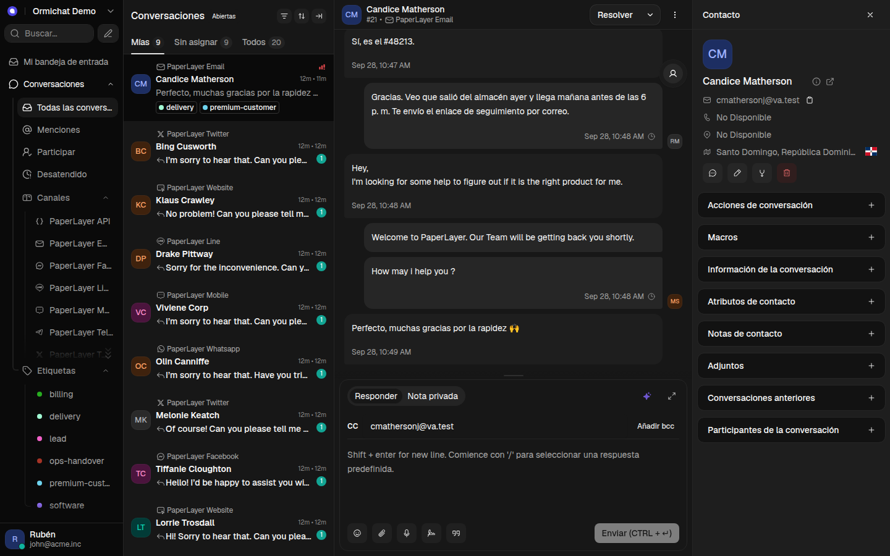
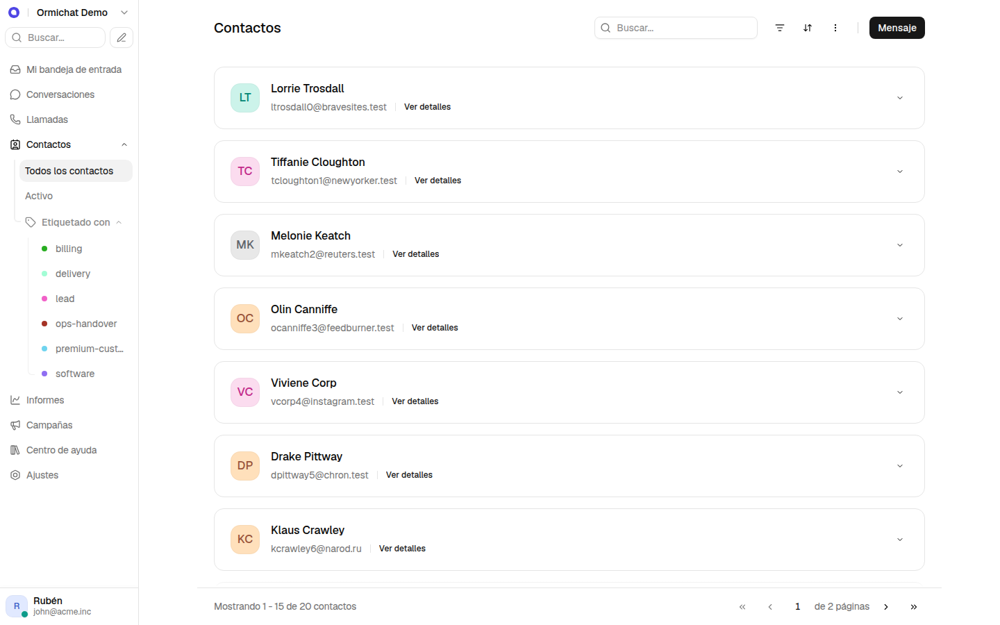
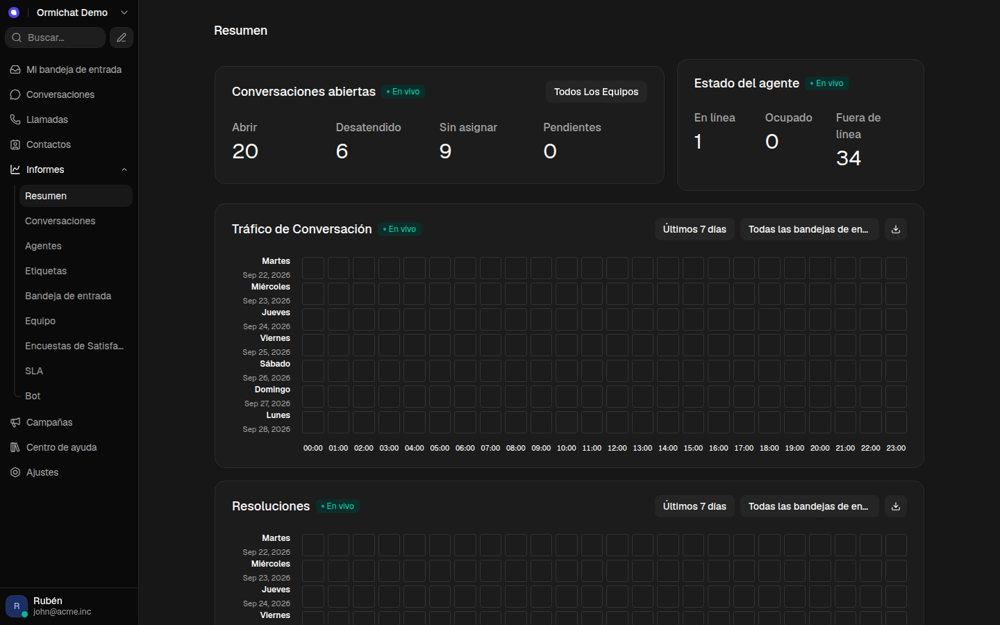
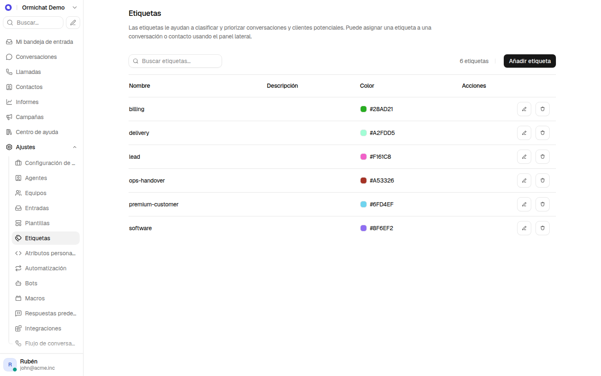
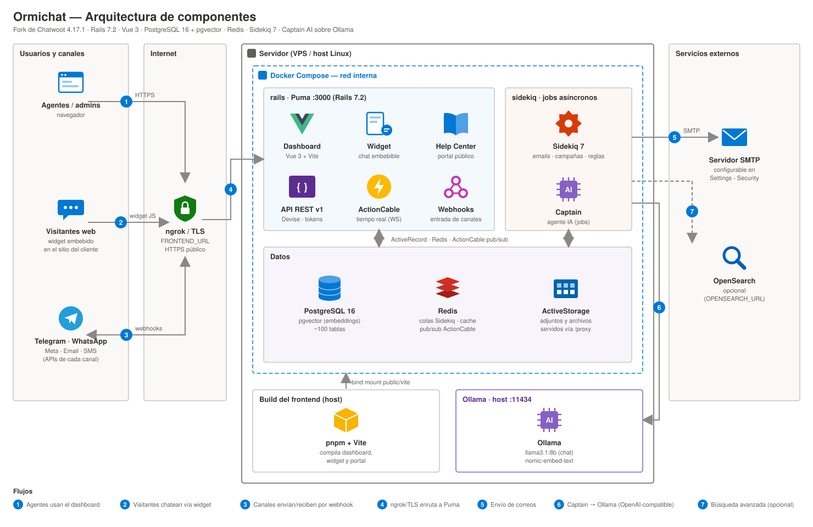

# Ormichat

Plataforma de atención al cliente **self-hosted** y omnicanal: bandeja compartida, contactos, automatizaciones, reportes, centro de ayuda y un agente de IA (**Captain**) que corre sobre un modelo **local de Ollama**, sin depender de OpenAI.

Ormichat es un fork independiente de **Chatwoot 4.17.1** con tema **shadcn/ui** (paleta neutral y tipografía Geist), interfaz en español y funciones propias como atributos de tipo archivo, etiquetas solo para automatizaciones y roles que controlan el menú lateral.

<p align="center">
  
  
</p>

**Contenido:** [Capturas](#capturas) · [Qué agrega Ormichat](#qué-agrega-ormichat) · [Arquitectura](#arquitectura) · [Modelo de datos](#modelo-de-datos) · [Stack](#stack) · [Puesta en marcha](#puesta-en-marcha) · [Desarrollo](#desarrollo) · [Documentación](#documentación)

---

## Capturas

| Conversación y panel de contacto (oscuro) | Contactos |
|---|---|
|  |  |
| **Informes en vivo (oscuro)** | **Ajustes › Etiquetas** |
|  |  |

> Capturas tomadas de la app corriendo en local con los datos de demostración de `Seeders::AccountSeeder`.

## Qué agrega Ormichat

Respecto a Chatwoot 4.17.1:

- **Tema shadcn/ui**: paleta neutral en claro y oscuro, radios y sombras de shadcn, tipografía Geist en todas las superficies (dashboard, widget, portal, encuestas, Super Admin y emails). Se logra solo con tokens de Tailwind, sin agregar dependencias.
- **Captain AI local**: el agente de IA usa Ollama (`llama3.1:8b` para chat y `nomic-embed-text` para embeddings) a través de un endpoint compatible con OpenAI. Sin costo por uso y sin datos saliendo del servidor.
- **Atributo personalizado tipo "Archivo"**: se adjunta al compositor como binario, se previsualizan imágenes y se sirve por la ruta *proxy* de ActiveStorage. Los enlaces se validan contra rutas de blobs para evitar XSS.
- **Panel de contacto**: ciudad, país con bandera, dirección, enlace seguro a Maps y formato de fechas/casillas en los atributos.
- **Etiquetas "solo automatización"** (`labels.selectable = false`): ocultas en los selectores de los agentes y rechazadas por la API para usuarios, disponibles para reglas y bots.
- **Roles personalizados → menú lateral**: cada rol define qué ítems del sidebar ve (`custom_roles.visible_menu_items`).
- **SMTP configurable desde la UI** (Ajustes › Seguridad), con recarga en caliente y correo de prueba.
- **Español completo** y rebranding a "Ormichat" (sin enlaces a chatwoot.com / chwt.app).

## Arquitectura



| # | Flujo |
|---|---|
| 1 | Los agentes usan el dashboard (Vue 3) servido por Rails. |
| 2 | Los visitantes chatean desde el widget embebido en el sitio del cliente. |
| 3 | Telegram, WhatsApp, Meta, email y SMS entregan mensajes por webhook y reciben las respuestas por sus APIs. |
| 4 | Un túnel ngrok (o un proxy con TLS en producción) expone `FRONTEND_URL` por HTTPS y enruta a Puma `:3000`. |
| 5 | Sidekiq envía los correos por el SMTP configurado. |
| 6 | Captain corre en jobs de Sidekiq y llama a Ollama en el host (`:11434`). |
| 7 | Búsqueda avanzada con OpenSearch, solo si se define `OPENSEARCH_URL`. |

Todo corre con `docker-compose.yml` (`postgres` con pgvector, `redis`, `setup`, `rails`, `sidekiq`) sobre una imagen propia construida desde este repo con `docker/Dockerfile` (el frontend se compila dentro del build). No depende de ninguna imagen de Chatwoot.

## Modelo de datos

Entidades principales (PostgreSQL, ~100 tablas en total). Todo está aislado por `account_id` (multi-tenant). Los campos marcados como *Ormichat* son propios de este fork.

```mermaid
erDiagram
    ACCOUNTS ||--o{ ACCOUNT_USERS : "tiene"
    USERS ||--o{ ACCOUNT_USERS : "pertenece"
    CUSTOM_ROLES |o--o{ ACCOUNT_USERS : "asigna rol"
    ACCOUNTS ||--o{ CUSTOM_ROLES : ""
    ACCOUNTS ||--o{ INBOXES : ""
    ACCOUNTS ||--o{ CONTACTS : ""
    ACCOUNTS ||--o{ LABELS : ""
    ACCOUNTS ||--o{ TEAMS : ""
    ACCOUNTS ||--o{ CUSTOM_ATTRIBUTE_DEFINITIONS : ""
    ACCOUNTS ||--o{ AUTOMATION_RULES : ""
    ACCOUNTS ||--o{ AGENT_BOTS : ""
    ACCOUNTS ||--o{ CAPTAIN_ASSISTANTS : ""
    ACCOUNTS ||--o{ PORTALS : ""
    INBOXES ||--|| CHANNEL : "channel_type + channel_id"
    INBOXES ||--o{ CONTACT_INBOXES : ""
    CONTACTS ||--o{ CONTACT_INBOXES : ""
    CONTACT_INBOXES ||--o{ CONVERSATIONS : ""
    INBOXES ||--o{ CONVERSATIONS : ""
    CONTACTS ||--o{ CONVERSATIONS : ""
    USERS |o--o{ CONVERSATIONS : "assignee"
    TEAMS |o--o{ CONVERSATIONS : ""
    CAMPAIGNS |o--o{ CONVERSATIONS : ""
    INBOXES ||--o{ CAMPAIGNS : ""
    CONVERSATIONS ||--o{ MESSAGES : ""
    MESSAGES ||--o{ ATTACHMENTS : ""
    LABELS }o--o{ CONVERSATIONS : "taggings"
    CAPTAIN_ASSISTANTS ||--o{ CAPTAIN_DOCUMENTS : ""
    CAPTAIN_ASSISTANTS ||--o{ CAPTAIN_ASSISTANT_RESPONSES : ""
    PORTALS ||--o{ ARTICLES : ""

    ACCOUNTS {
        bigint id PK
        string name
        int locale
        bigint feature_flags
        jsonb settings
    }
    USERS {
        bigint id PK
        string email
        string name
        int availability
    }
    ACCOUNT_USERS {
        bigint account_id FK
        bigint user_id FK
        int role "agent | administrator"
        bigint custom_role_id FK
    }
    CUSTOM_ROLES {
        bigint id PK
        string name
        text permissions
        text visible_menu_items "Ormichat"
    }
    INBOXES {
        bigint id PK
        string name
        string channel_type "Channel::Telegram, WebWidget..."
        int channel_id
        bool enable_auto_assignment
    }
    CHANNEL {
        bigint id PK
        string provider_config "una tabla channel_* por canal"
    }
    CONTACTS {
        bigint id PK
        string name
        string email
        string phone_number
        string location
        string country_code
        jsonb additional_attributes "city, country, address"
        jsonb custom_attributes "incluye tipo archivo"
    }
    CONTACT_INBOXES {
        bigint contact_id FK
        bigint inbox_id FK
        text source_id
    }
    CONVERSATIONS {
        bigint id PK
        int display_id
        int status "open | resolved | pending | snoozed"
        bigint assignee_id FK
        bigint team_id FK
        jsonb custom_attributes
        text cached_label_list
    }
    MESSAGES {
        bigint id PK
        bigint conversation_id FK
        int message_type "incoming | outgoing | activity"
        text content
        bool private
        string sender_type
        bigint sender_id
    }
    ATTACHMENTS {
        bigint id PK
        bigint message_id FK
        int file_type
        string external_url
    }
    LABELS {
        bigint id PK
        string title
        string color
        bool selectable "Ormichat: false = solo automatizaciones"
    }
    CUSTOM_ATTRIBUTE_DEFINITIONS {
        bigint id PK
        string attribute_key
        int attribute_display_type "Ormichat agrega file"
        int attribute_model "contact | conversation"
    }
    TEAMS {
        bigint id PK
        string name
    }
    AUTOMATION_RULES {
        bigint id PK
        string event_name
        jsonb conditions
        jsonb actions
    }
    AGENT_BOTS {
        bigint id PK
        string name
        string outgoing_url
    }
    CAMPAIGNS {
        bigint id PK
        string title
        int campaign_type
        jsonb audience
    }
    CAPTAIN_ASSISTANTS {
        bigint id PK
        string name
        jsonb config
        jsonb guardrails
    }
    CAPTAIN_DOCUMENTS {
        bigint id PK
        text external_link
        text content
    }
    CAPTAIN_ASSISTANT_RESPONSES {
        bigint id PK
        string question
        text answer
        vector embedding "pgvector, 768 dims"
    }
    PORTALS {
        bigint id PK
        string slug
        string custom_domain
    }
    ARTICLES {
        bigint id PK
        string title
        text content
        int status
    }
```



Esquema completo en [`db/schema.rb`](db/schema.rb).

## Stack

| Capa | Tecnología |
|---|---|
| Frontend | Vue 3.5 (Composition API, `<script setup>`), Vite 6, Tailwind CSS (tema shadcn/ui), Vitest, Histoire |
| Backend | Ruby 3.4.4, Rails 7.2, Puma, Devise, ActionCable |
| Jobs | Sidekiq 7 sobre Redis |
| Base de datos | PostgreSQL 16 + pgvector |
| IA | Captain vía `ruby_llm` → Ollama (API compatible con OpenAI) |
| Búsqueda | Searchkick + OpenSearch (opcional) |
| Archivos | ActiveStorage (servido por la ruta `/proxy`) |
| Despliegue | Docker Compose con imagen propia, proxy TLS para HTTPS público |
| Herramientas | pnpm 10, Node 24, RuboCop, ESLint |

## Puesta en marcha

Requisitos: Docker + Docker Compose, y Ollama si se quiere usar Captain.

```bash
git clone https://github.com/martinezruben/ormichat.git
cd ormichat

cp .env.example .env      # completar FRONTEND_URL, SECRET_KEY_BASE y POSTGRES_PASSWORD
docker compose up -d --build
```

La app queda en `http://localhost:3000`. Rebranding, habilitación de módulos, HTTPS con ngrok, canales con webhook y la configuración de Captain sobre Ollama están paso a paso en [`INSTALL.md`](INSTALL.md).

## Desarrollo

```bash
bundle install && pnpm install               # dependencias
bundle exec rails db:chatwoot_prepare        # base de datos local
overmind start -f Procfile.dev               # Rails + Sidekiq + Vite

pnpm test                                    # tests JS/Vue (Vitest)
bundle exec rspec spec/ruta/al_spec.rb       # tests Ruby
pnpm eslint:fix                              # lint JS/Vue
bundle exec rubocop -a                       # lint Ruby
```

Datos de demostración para una cuenta: `bundle exec rails runner "Seeders::AccountSeeder.new(account: Account.first).perform!"`.

## Documentación

| Archivo | Contenido |
|---|---|
| [`Context.md`](Context.md) | Qué es el proyecto, mapa del repo y customizaciones respecto a Chatwoot |
| [`INSTALL.md`](INSTALL.md) | Despliegue con Docker, rebranding, ngrok, Captain sobre Ollama, troubleshooting |
| [`AGENTS.md`](AGENTS.md) | Convenciones de código, i18n, commits y PRs, reglas del overlay Enterprise |
| [`SECURITY.md`](SECURITY.md) | Reporte de vulnerabilidades |

## Licencia

Basado en [Chatwoot](https://github.com/chatwoot/chatwoot) © Chatwoot Inc., publicado bajo licencia MIT (ver [`LICENSE`](LICENSE)). Las customizaciones de Ormichat se distribuyen bajo la misma licencia.
